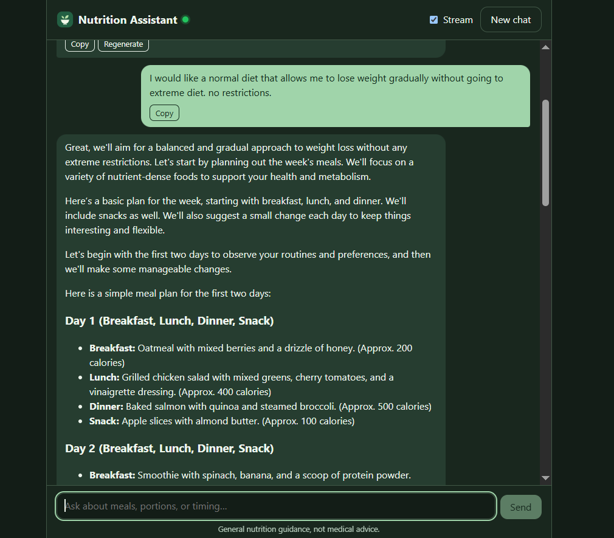

# Nutrition Assistant (FastAPI + React)

A nutrition chat backed by FastAPI and a local Ollama model. Ask for meal ideas, help scaling recipes, or a meal schedule. Guidance is general and does not replace medical advice.

## Demo



## Server (`server/`)

Requires [Ollama](https://ollama.com) running locally with a model that supports tool calling (default `qwen2.5:3b`).

```powershell
cd server
python -m venv .venv
.\.venv\Scripts\pip install -r requirements.txt
.\.venv\Scripts\python -m uvicorn main:app --reload --port 8000
```

Env vars: `OLLAMA_URL` (default `http://localhost:11434`), `OLLAMA_MODEL` (default `qwen2.5:3b`), `OLLAMA_API_KEY` (optional upstream bearer token), and `CORS_ORIGINS` (comma-separated browser origins for cross-origin API calls).

`LLM_PROVIDER` selects the backend implementation (currently only `ollama`, the default). The API handles filtering and system instructions, while `ChatService` runs the tool loop using provider-neutral DTOs from `llm_models.py` and the `LLMProvider` interface. Public API DTOs live in `api_models.py`; `OllamaProvider` owns Ollama-specific schemas, configuration, HTTP payloads, streaming decoding, and diagnostics. To add OpenAI or Anthropic, implement `LLMProvider` and register it in `providers.py`; the routes and tool logic do not need provider-specific changes. The `/health` response keeps its existing `ollama` field for client compatibility.

For [direct Ollama Cloud access](https://docs.ollama.com/cloud/api), set `OLLAMA_URL=https://ollama.com/api` and provide an `OLLAMA_API_KEY`. Try an exact API model ID such as `gemma4:31b`, the one in Ollama's cloud example. The backend accepts URLs with or without the trailing `/api`. Check the [deployment guide](infrastructure/k8s/README.md#troubleshoot-ollama) for failure logs on Kubernetes.

Both endpoints accept the same payload:

```json
{ "messages": [{ "role": "user", "content": "Hello" }] }
```

Both endpoints use `OLLAMA_MODEL` when the request omits `model`, as the web client does. API callers can still supply `model` to override the default for a single request.

- `POST /chat` → `{ "model": "...", "message": { "role": "assistant", "content": "..." } }`
- `POST /chat-stream` → `text/plain` stream of tokens
- `GET /health` → `{ "status": "ok", "ollama": true }` (`ollama` reports whether Ollama is reachable)
- `GET /healthz` → `{ "status": "ok" }` (process health; does not depend on Ollama)

Send only `user` and `assistant` messages. The server prepends its own nutrition instructions and handles tool calls internally; neither the system message nor raw tool messages are returned. This is not a guarantee against the model repeating its instructions, so keep secrets out of the prompt.

Both chat endpoints screen client-supplied messages locally for common prompt injection patterns before calling Ollama. They omit flagged messages and report their zero-based request indices in `X-Filtered-Message-Indices`. If no usable user message remains, the API returns HTTP 422 without calling Ollama. This heuristic can miss attacks or flag benign messages; it is not a security boundary.

The assistant can evaluate basic arithmetic, look up the current date and time in an IANA time zone, and shift a date or local meal time by days or minutes. Schedules are suggestions, not calendar events or reminders.

Swagger UI: http://localhost:8000/docs (ReDoc: `/redoc`).

Tests (Ollama is mocked with `respx`, no live model needed):

```powershell
.\.venv\Scripts\pip install -r requirements-dev.txt
.\.venv\Scripts\python -m pytest
```

## Client (`client/`)

```powershell
cd client
npm install
npm run dev
```

Open http://localhost:5173. The Vite dev server proxies `/api/*` to `http://localhost:8000`.

The dot next to the title polls `/health` every 5s (paused while the tab is hidden): green = online, amber = server up but Ollama unreachable, red = server offline.

Flagged messages remain visible with a **Possible prompt injection** label, but are left out of the model's context. Use **Copy** on either side of the conversation (HTTPS or localhost); assistant replies copy the Markdown source. **Regenerate** replaces the selected reply using only the preceding messages and leaves later turns unchanged. Assistant replies render Markdown, including meal schedule tables. Raw HTML is ignored, links are displayed as text, and Markdown images show only their alt text without fetching the URL.

The browser reads `window._env_.API_URL` from `env-config.js` at startup. The frontend container generates that file from `API_URL`, so the API base can change without rebuilding the image. When no runtime value is set, the app uses Vite's `VITE_API_BASE` or defaults to same-origin `/api`.

Tests (Vitest + Testing Library, `fetch` is mocked): `npm test` (or `npm run test:watch`).

## Deployment

The server and client have separate Dockerfiles. On Kubernetes, the HTTPS Ingress routes to the frontend, and nginx forwards `/api/*` to FastAPI without buffering streaming replies. Ollama runs separately and is configured through the backend ConfigMap. The app does not require user sign-in; anyone who can reach the site can make requests to its configured model.

See the [Kubernetes deployment guide](infrastructure/k8s/README.md) for cluster prerequisites, configuration, local Docker usage, and rollout commands. GitHub Actions checks pull requests and pushes to `master`; a version tag such as `v1.2.3` publishes both images to GHCR and creates a GitHub Release.
