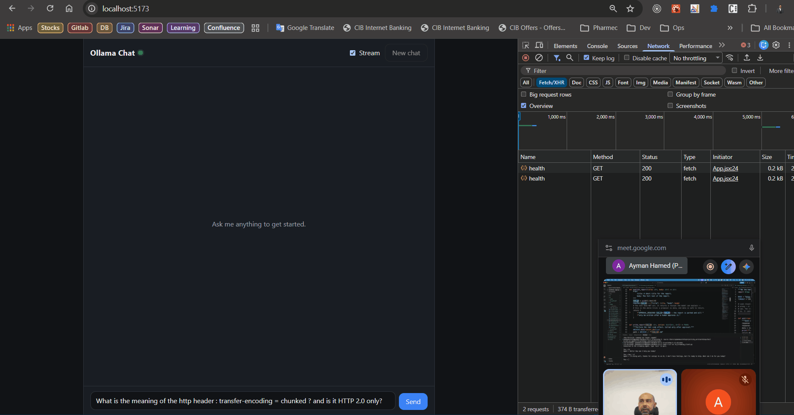

# Ollama Chat (FastAPI + React)

A responsive React chat interface backed by FastAPI and a local Ollama model, with streaming replies and a live server status indicator.

## Demo



## Server (`server/`)

Requires [Ollama](https://ollama.com) running locally (default model `qwen2.5:3b`).

```powershell
cd server
python -m venv .venv
.\.venv\Scripts\pip install -r requirements.txt
.\.venv\Scripts\python -m uvicorn main:app --reload --port 8000
```

Env vars: `OLLAMA_URL` (default `http://localhost:11434`), `OLLAMA_MODEL` (default `qwen2.5:3b`), `CORS_ORIGINS`.

Both endpoints accept the same payload:

```json
{ "messages": [{ "role": "user", "content": "Hello" }], "model": "qwen2.5:3b" }
```

- `POST /chat` → `{ "model": "...", "message": { "role": "assistant", "content": "..." } }`
- `POST /chat-stream` → `text/plain` stream of tokens
- `GET /health` → `{ "status": "ok", "ollama": true }` (`ollama` reports whether Ollama is reachable)

Swagger UI: http://localhost:8000/docs (ReDoc: `/redoc`).

Tests (Ollama is mocked with `respx`, no live model needed):

```powershell
.\.venv\Scripts\pip install -r requirements-dev.txt
.\.venv\Scripts\python -m pytest
```

## Client (`client/`)

```powershell
cd client
npm install
npm run dev
```

Open http://localhost:5173. The Vite dev server proxies `/api/*` to `http://localhost:8000`.

The dot next to the title polls `/health` every 5s (paused while the tab is hidden): green = online, amber = server up but Ollama unreachable, red = server offline.

Tests (Vitest + Testing Library, `fetch` is mocked): `npm test` (or `npm run test:watch`).
